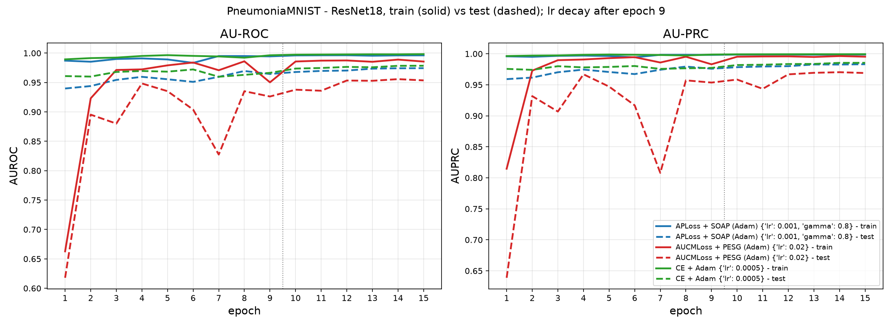
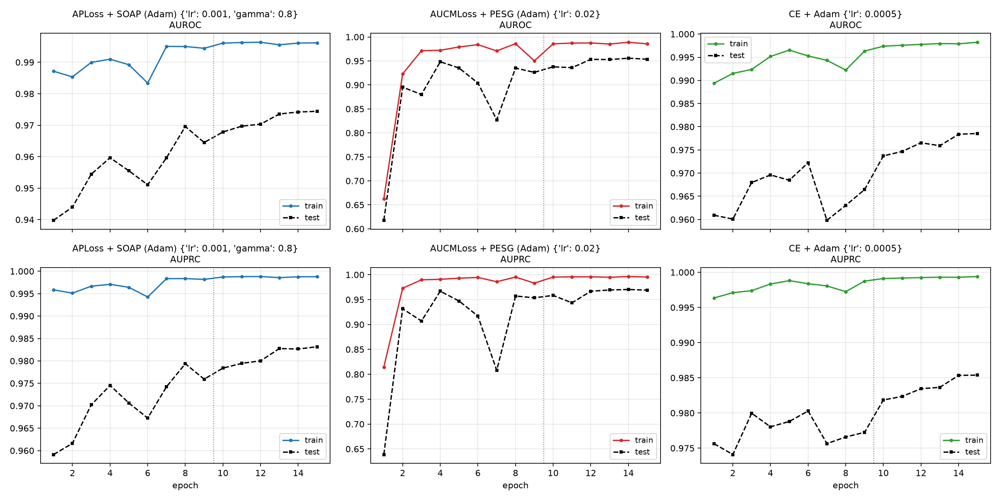

# 5. Optimizing AUC on Imbalanced MedMNIST with LibAUC

**Interfaces used:** PyTorch 2.x (Apple-silicon GPU, `mps`), LibAUC 1.4.0 (`APLoss`, `SOAP`, `AUCMLoss`, `PESG`, `CrossEntropyLoss`, `resnet18`, `DualSampler`, `auc_roc_score`, `auc_prc_score`), MedMNIST 3.0.2, torchvision transforms, matplotlib.
Code: `LibAUC/hw5_libauc.py` (`python hw5_libauc.py tune` then `python hw5_libauc.py plot`).

## (a) Data loading and augmentation

- **Loading:** `medmnist.PneumoniaMNIST` at 28×28 resolution, using the official train, val and test splits.

  | split | images |
  |---|---|
  | train | 4708 (3494 pneumonia = label 1, 1214 normal) |
  | val | 524 |
  | test | 624 |

- **Index fix (Note 6):** LibAUC needs each sample's index, so I subclassed `PneumoniaMNIST` so that `__getitem__` returns `(index, img, target)`. This avoids editing `medmnist/dataset.py`.
- **Train transform:** `ToTensor → RandomCrop(26) → RandomHorizontalFlip → Resize(32)`. The codebase crops 30 out of 32; these images are 28×28, so I crop 26 (2 px less than the image size).
- **Test and eval transform:** `ToTensor → Resize(32)`.
- **Model:** LibAUC `resnet18(num_classes=1, last_activation=None)`. The first layer `model.conv1` is replaced by `nn.Conv2d(1, 64, 7, stride=2, padding=3, bias=False)` so the network takes 1-channel input.

## (b) Training

**Settings shared by all three models:**
- 15 epochs, batch size 64, weight decay 0.
- Learning rate divided by 10 at epoch 9.
- Seed 123.
- Predictions are passed through a sigmoid before AUROC and AUPRC are computed.

| model | loss / optimizer | sampling | other settings (from the codebase) |
|---|---|---|---|
| (i) | `APLoss(data_len, margin=0.6, gamma)` + `SOAP(mode='adam')` | `DualSampler(sampling_rate=0.5)` | lr decay via `update_lr(10)` |
| (ii) | `AUCMLoss(margin=1.0)` + `PESG(mode='adam', epoch_decay=0.003)` | `DualSampler(sampling_rate=0.5)` | at epoch 9, `update_regularizer(10)` divides lr by 10 and resets the reference point |
| (iii) | `CrossEntropyLoss` (sigmoid + BCE) + `torch.optim.Adam` | uniform shuffle | — |

**Tuning:**
- APLoss: lr ∈ {5e-4, 1e-3, 2e-3} × γ ∈ {0.2, 0.5, 0.8}.
- PESG: lr ∈ {0.02, 0.05, 0.1}.
- CE: lr ∈ {5e-4, 1e-3, 2e-3}.

Each configuration is selected by its **final-epoch validation** score. That score is AUPRC for APLoss and AUROC for AUCM and CE, i.e. the metric each loss targets; CE has no target metric, so AUROC is used. The test set is never used for selection.

### Full grid (final epoch)

| method | config | val AUROC | val AUPRC | test AUROC | test AUPRC |
|---|---|---|---|---|---|
| AP + SOAP | lr 5e-4, γ 0.2 | 0.9938 | 0.9980 | 0.9725 | 0.9824 |
| AP + SOAP | lr 5e-4, γ 0.5 | 0.9939 | 0.9979 | 0.9745 | 0.9834 |
| AP + SOAP | lr 5e-4, γ 0.8 | 0.9935 | 0.9977 | 0.9750 | 0.9838 |
| AP + SOAP | lr 1e-3, γ 0.2 | 0.9931 | 0.9977 | 0.9734 | 0.9828 |
| AP + SOAP | lr 1e-3, γ 0.5 | 0.9931 | 0.9976 | 0.9743 | 0.9836 |
| **AP + SOAP** | **lr 1e-3, γ 0.8** | 0.9950 | **0.9984** | 0.9744 | 0.9832 |
| AP + SOAP | lr 2e-3, γ 0.2 | 0.9948 | 0.9983 | 0.9696 | 0.9804 |
| AP + SOAP | lr 2e-3, γ 0.5 | 0.9930 | 0.9976 | 0.9708 | 0.9815 |
| AP + SOAP | lr 2e-3, γ 0.8 | 0.9930 | 0.9976 | 0.9691 | 0.9800 |
| **AUCM + PESG** | **lr 0.02** | **0.9869** | 0.9956 | 0.9536 | 0.9690 |
| AUCM + PESG | lr 0.05 | 0.9830 | 0.9940 | 0.9408 | 0.9624 |
| AUCM + PESG | lr 0.1 | 0.9673 | 0.9881 | 0.9171 | 0.9381 |
| **CE + Adam** | **lr 5e-4** | **0.9965** | 0.9988 | 0.9785 | 0.9854 |
| CE + Adam | lr 1e-3 | 0.9958 | 0.9986 | 0.9768 | 0.9846 |
| CE + Adam | lr 2e-3 | 0.9958 | 0.9986 | 0.9811 | 0.9877 |

### Selected models (final epoch)

| model | selected hyper-parameters | train AUROC | train AUPRC | **test AUROC** | **test AUPRC** |
|---|---|---|---|---|---|
| (i) APLoss + SOAP | lr = 1e-3, γ = 0.8 | 0.9962 | 0.9988 | **0.9744** | **0.9832** |
| (ii) AUCMLoss + PESG | lr = 0.02 | 0.9856 | 0.9953 | **0.9536** | **0.9690** |
| (iii) CE + Adam | lr = 5e-4 | 0.9982 | 0.9994 | **0.9785** | **0.9854** |

## (c) Curves and observations

The figures show 12 curves: AUROC and AUPRC, on train and test, for each of the 3 models. The dotted line marks the lr decay.

**Observations:**

1. **There is a train–test gap for all models.** Train AUROC and AUPRC reach about 0.99 or higher within a few epochs, while test scores level off around 0.95–0.98.
   - Part of the gap is overfitting with only 4.7k training images.
   - Part of it is a known distribution shift in PneumoniaMNIST: the validation scores, taken from the same distribution as train, stay at about 0.99, while test scores are about 2 points lower for every method.
2. **The learning-rate decay at epoch 9 stabilizes training.** Before epoch 9, all test curves are noisy. CE drops from 0.972 to 0.960 test AUROC between epochs 6 and 7, and PESG falls to 0.83 at epoch 7. After the 10× decay, every curve becomes smooth and rises steadily. All three models reach their best or near-best test scores in the last 2–3 epochs, so 15 epochs with one decay is a reasonable budget.
3. **AUCMLoss + PESG starts worst and is the least stable.**
   - It starts at about 0.62 test AUROC after epoch 1, compared with about 0.94–0.96 for the other two, because the min-max objective needs time to estimate the class means `a`, `b` and the dual variable `α`.
   - It has the largest swings before the decay. The prescribed lr range {0.02, 0.05, 0.1} is large for Adam-style updates, and validation performance falls steadily as lr increases (0.987 → 0.983 → 0.967 val AUROC).
   - After the decay it recovers to 0.954 test AUROC and 0.969 test AUPRC, but stays below the other two. With more epochs or a smaller lr it would probably close the gap.
4. **APLoss + SOAP improves AUPRC smoothly.**
   - Its train AUPRC is about 0.999. Its test AUPRC rises almost monotonically after epoch 6, to 0.983.
   - It is fairly insensitive to γ: all 9 configurations land within 0.980–0.984 test AUPRC.
   - The learning rate matters more: lr = 2e-3 is consistently worst.
5. **CE + Adam is the best model here, by a small margin.** It reaches 0.979 test AUROC and 0.985 test AUPRC, against 0.974 and 0.983 for APLoss + SOAP.
   - This is expected for this dataset: it is only mildly imbalanced, and the *positive* class is the majority (74%).
   - AUC and AP losses mainly help when positives are rare. Here AUPRC is already about 0.98 for every method, so there is little room for a ranking loss to help.
   - Changing CE to optimize the ranking directly does not buy much when the classes are this separable. Also, `DualSampler` (sampling rate 0.5) *oversamples the minority negatives* rather than the positives.
6. **AUROC and AUPRC move together.** For every model the two curves have the same shape. AUPRC is always higher than AUROC because positives are the majority, so the AUPRC of a random classifier equals the positive rate: about 0.74 on train and 0.63 on test (390 of 624), compared with 0.5 AUROC.
